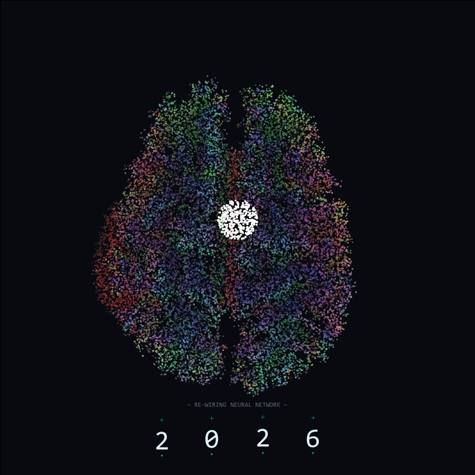

# Cristalización 2026 ➔ 2027 — Visualizador Neuro-Indie

Pieza de arte generativo e interactivo desarrollada en **Processing (Java)**. El proyecto realiza un procesado cromático en tiempo real sobre una imagen de tractografía cerebral (`axial_brain.jpeg`), aislando las fibras nerviosas y superponiendo un sistema de partículas reactivas, un pulso de energía y una interfaz HUD que conmuta la transición de año de **2026 a 2027**.



---

### Autoría y Créditos

* **Desarrollo y Arte Generativo:** Pamela Franco

---

### Características principales

* **Filtrado Cromático ARGB:** Limpieza de fondo en tiempo real que remueve mallas y tonos grises midiendo la variación de color (`colorDiff`), aislando únicamente la estructura de fibras nerviosas.
* **Mapeo de Partículas Neurales:** Partículas posicionadas exclusivamente sobre la red axonal que responden con vibración y destellos de brillo al paso del pulso.
* **Transición Dinámica 2026 ➔ 2027:**
  * Onda expansiva de energía que recorre la red sináptica.
  * Conmutación automática o por clic del último dígito de '6' a '7'.
  * Emisión de chispas interactivas (`Spark`) al consolidar el año 2027.
* **HUD Tipográfico Interactivo:**
  * Renderizado en fuente `Consolas`.
  * Cambio de estado tipográfico: `— RE-WIRING NEURAL NETWORK —` durante la carga y `— SYNAPSE LINK :: ESTABLISHED 2027 —` al conectar el pulso.
* **Grabador de Secuencia:** Exportación automática de 240 fotogramas en formato PNG dentro de la carpeta `/secuencia_frames`.

---

### Tecnologías utilizadas

* **Processing 3 / 4** (Modo Java)
* **PImage & ARGB Manipulation** — Filtrado de píxeles y mapa de transparencia alpha.
* **PVector** — Simulación de física de partículas y dispersión de chispas.

---

### Estructura del Repositorio

```text
xmas-2026/
├── sketch_251211h.pde       # Código principal en Processing
├── axial_brain.jpeg         # Imagen de tractografía cerebral
├── secuencia_frames/        # Fotogramas generados (.png)
└── README.md                # Documentación del repositorio
```